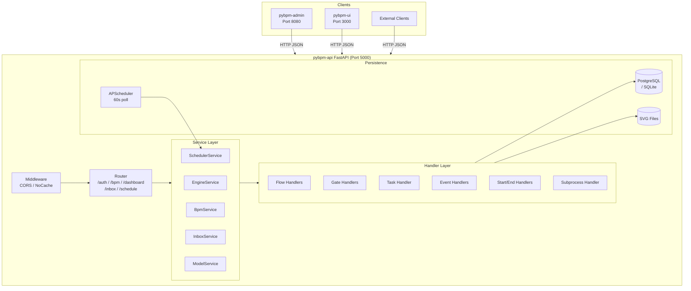
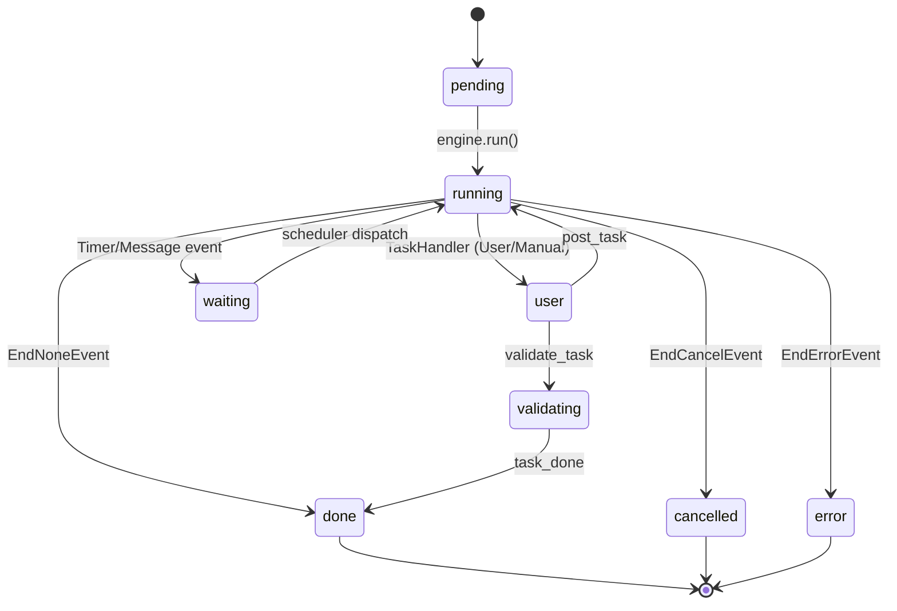
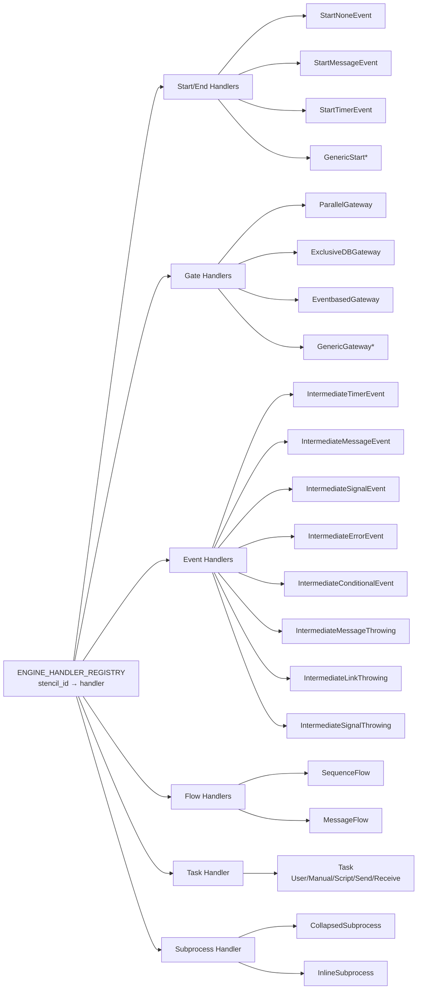
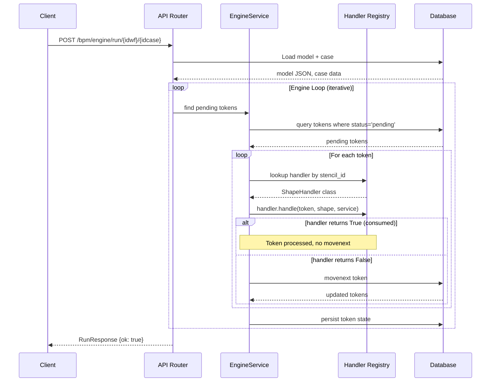

# PyBPM API

**Migrated PHP HMVC BPM Engine Backend** — a FastAPI service that powers the PyBPM workflow engine, model repository, and dashboard APIs.

## Architecture

### System Architecture



### Token Lifecycle



## Tech Stack

| Layer | Technology |
|-------|-----------|
| Framework | FastAPI (async), Starlette |
| ORM | SQLAlchemy 2.0 (async with `asyncpg` / `aiosqlite`) |
| Migrations | Alembic |
| Scheduler | APScheduler (BackgroundScheduler, 60s poll) |
| Auth | python-jose (JWT HS256), passlib/bcrypt |
| Server | uvicorn |
| Database | PostgreSQL (production), SQLite (dev) |
| Testing | pytest, pytest-asyncio, httpx, pytest-xdist |
| Linting | Ruff, Black |

## Project Structure

```
pybpm-api/
├── main.py                  # FastAPI app, middleware, router wiring
├── extensions.py            # Async engine/session factories, DB deps
├── config.py                # Pydantic-settings-style Config class
├── pyproject.toml           # Dependencies + tool config
├── Dockerfile               # Multi-stage: python:3.14-slim + uv
├── docker-compose.yml       # App + PostgreSQL service
├── boot.sh                  # Startup: db migration → uvicorn
├── init.sql                 # Initial DB schema
├── app/
│   ├── __init__.py
│   ├── api/
│   │   ├── auth.py          # POST /auth/token, GET /auth/me
│   │   ├── bpm/
│   │   │   ├── engine.py    # Case lifecycle: newcase, start, run, post, assign
│   │   │   ├── repository.py # Model CRUD: save, load, dump, delete, import, svg
│   │   │   ├── cases.py     # Case management endpoints
│   │   │   ├── tokens.py    # Token management
│   │   │   ├── token_manager.py
│   │   │   └── event_schedule.py
│   │   ├── dashboard.py     # Case/task counts, task lifecycle (lock/unlock/validate/done)
│   │   ├── inbox.py         # Inbox message filtering, CRUD
│   │   └── engine.py        # Engine API router (prefix: /bpm/engine)
│   ├── core/
│   │   ├── logging.py       # Uvicorn log config builder
│   │   └── scheduler.py     # APScheduler start/stop
│   ├── handlers/
│   │   ├── __init__.py      # Auto-registration of all handlers
│   │   ├── flow.py          # SequenceFlow, MessageFlow, _safe_eval
│   │   ├── gate.py          # ParallelGateway, ExclusiveDatabasedGateway, EventbasedGateway
│   │   ├── task.py          # User/Manual/Script/Send/Receive task types
│   │   ├── event.py         # Intermediate events (timer, message, signal, error, etc.)
│   │   ├── start_end.py     # StartNone/Message/Timer, EndNone/Message/Error/Cancel/Terminate
│   │   ├── subproc.py       # CollapsedSubprocess (child case delegation)
│   │   └── eval_context.py  # Script execution namespace builder
│   ├── models/
│   │   ├── base.py          # SQLAlchemy DeclarativeBase
│   │   ├── bpm_model.py     # BpmModel — BPMN model JSON + SVG storage
│   │   ├── case.py          # BpmCase — case instance (parent/child hierarchy)
│   │   ├── token.py         # Token, TokenHistory — workflow execution tokens
│   │   ├── user.py          # User
│   │   ├── group.py         # Group
│   │   ├── user_group.py    # UserGroup
│   │   ├── permission_group.py
│   │   ├── permission_repository.py
│   │   ├── message.py       # Message — inbox items
│   │   ├── signal.py        # Signal definitions
│   │   ├── event_schedule.py # Scheduled event triggers
│   │   └── __init__.py
│   ├── schemas/
│   │   ├── case.py
│   │   ├── dashboard.py
│   │   ├── engine.py
│   │   ├── event_schedule.py
│   │   ├── inbox.py
│   │   ├── repository.py
│   │   ├── token.py
│   │   └── __init__.py
│   └── services/
│       ├── engine_service.py  # Core engine: token lifecycle, shape dispatch, movenext
│       ├── bpm_service.py     # gen_case, startcase, subprocess orchestration
│       ├── scheduler_service.py # Due schedule dispatch
│       ├── inbox_service.py   # Inbox message operations
│       ├── model_service.py   # Model CRUD operations
│       ├── event_schedule_service.py
│       └── signal_service.py
├── tests/
│   ├── conftest.py
│   ├── test_engine_service.py
│   ├── test_flow_handlers.py
│   ├── test_gate_handlers.py
│   ├── test_task_handlers.py
│   ├── test_eval_context.py
│   ├── test_cancel_logic.py
│   ├── test_dashboard_lock_unlock.py
│   ├── test_dashboard_tasks.py
│   ├── test_inbox_api.py
│   ├── test_movenext_outgoing.py
│   └── test_event_schedule_api.py
├── tools/
│   ├── seed_models.py
│   ├── seed_tasktype.py
│   ├── seed_users.py
│   └── test_model*.py
└── files/
    └── images/
        ├── model/
        ├── svg/
        └── zip/           # BPMN model archives (test cases)
```

## BPM Engine Architecture

The engine processes BPMN 2.0 models by dispatching tokens through a registry of shape handlers. Each shape type has a dedicated handler class that implements the BPMN semantics.

### Shape Handler Registry



### Engine Execution Flow



### Handler Interface

Each handler implements a standard interface:

```python
class ShapeHandler:
    STENCIL_ID: str  # BPMN stencil ID (e.g. "ParallelGateway")

    async def handle(
        self,
        token: Token,          # Current token being processed
        shape: dict,           # Shape data from model JSON
        service: EngineService, # DB access + engine utilities
    ) -> bool:
        """
        Returns True if the handler consumed the token (no movenext needed).
        Returns False if the handler wants the engine to call movenext.
        """
        ...
```

### Key BPMN Constructs Supported

| Construct | Handler | Notes |
|-----------|---------|-------|
| StartNoneEvent | `StartNoneEventHandler` | Default start |
| StartMessageEvent | `StartMessageEventHandler` | Waits for message |
| StartTimerEvent | `StartTimerEventHandler` | Time-based trigger |
| EndNoneEvent | `EndNoneEventHandler` | Normal completion |
| EndMessageEvent | `EndMessageEventHandler` | Throws message |
| EndErrorEvent | `EndErrorEventHandler` | Error termination |
| EndCancelEvent | `EndCancelEventHandler` | Cancel subcases |
| EndTerminateEvent | `EndTerminateEventHandler` | Hard terminate |
| ParallelGateway | `ParallelGatewayHandler` | Split/join parallel |
| ExclusiveDBGateway | `ExclusiveDatabasedGatewayHandler` | Data-based branching |
| EventbasedGateway | `EventbasedGatewayHandler` | Event-based split |
| SequenceFlow | `SequenceFlowHandler` | Default flow |
| MessageFlow | `MessageFlowHandler` | Message flow |
| UserTask | `TaskHandler` | Status='user', waits for POST |
| ManualTask | `TaskHandler` | Status='user' |
| ScriptTask | `TaskHandler` | Eval Python script, movenext |
| SendTask | `TaskHandler` | movenext (deferred dispatch) |
| ReceiveTask | `TaskHandler` | Waits for message |
| CollapsedSubprocess | `CollapsedSubprocessHandler` | Creates child case |
| IntermediateTimerEvent | `IntermediateTimerEventHandler` | Timer wait |
| IntermediateMessageEvent* | `IntermediateMessageEvent*Handler` | Message wait/throw |
| IntermediateSignalEvent* | `IntermediateSignalEvent*Handler` | Signal wait/throw |
| IntermediateErrorEvent | `IntermediateErrorEventHandler` | Error catching |
| IntermediateConditionalEvent | `IntermediateConditionalEventHandler` | Condition check |

## API Endpoints

### Authentication

| Method | Endpoint | Description |
|--------|----------|-------------|
| POST | `/api/v1/auth/token` | Login (OAuth2 password flow) |
| GET | `/api/v1/auth/me` | Get current user |

### BPM Repository

| Method | Endpoint | Description |
|--------|----------|-------------|
| POST | `/api/v1/bpm/repository/save` | Save/update model |
| POST | `/api/v1/bpm/repository/save_as` | Save as new model |
| POST | `/api/v1/bpm/repository/duplicate` | Clone model |
| POST | `/api/v1/bpm/repository/add` | Create empty model scaffold |
| GET | `/api/v1/bpm/repository/load/model/{idwf}` | Load model data |
| GET | `/api/v1/bpm/repository/dump/model/{idwf}` | Dump model + metadata |
| DELETE | `/api/v1/bpm/repository/delete` | Delete model |
| GET | `/api/v1/bpm/repository/svg/{idwf}` | Serve model SVG |
| GET | `/api/v1/bpm/repository/get_shapes/model/{idwf}` | Get shape metadata |
| GET | `/api/v1/bpm/repository/get_comments/model/{idwf}/{resource_id}` | Get shape documentation |
| POST | `/api/v1/bpm/repository/import` | Import model from zip |
| POST | `/api/v1/bpm/repository/update_folder` | Move model to folder |
| GET | `/api/v1/bpm/repository/check_model/{name}` | Check model name uniqueness |
| POST | `/api/v1/bpm/repository/save_script/{idwf}/{resource_id}` | Save script (stub) |
| POST | `/api/v1/bpm/repository/save_model/{idwf}` | Persist data + SVG payload |
| GET | `/api/v1/bpm/repository/thumbnail/{idwf}/{w}/{h}` | Thumbnail (stub) |
| GET | `/api/v1/bpm/repository/tokens/{idwf}/{idcase}/{filter_status}` | Get tokens (stub) |
| POST | `/api/v1/bpm/repository/get_tree2/{format}` | Build model tree (ExtJS format) |

### BPM Engine

| Method | Endpoint | Description |
|--------|----------|-------------|
| POST | `/api/v1/bpm/engine/newcase` | Create new case instance |
| POST | `/api/v1/bpm/engine/start` | Start/resume case at start shapes |
| POST | `/api/v1/bpm/engine/run/{idwf}/{idcase}` | Execute engine loop |
| POST | `/api/v1/bpm/engine/post/{idwf}/{idcase}/{resource_id}` | POST data to waiting task (path-based lookup) |
| POST | `/api/v1/bpm/engine/post/{token_id}` | POST data to waiting task (legacy token-ID lookup) |
| POST | `/api/v1/bpm/engine/assign` | Assign task to users |
| POST | `/api/v1/bpm/engine/gate_decision` | Manual gateway decision |
| POST | `/api/v1/bpm/engine/task_complete` | Complete manual task |

### Dashboard

| Method | Endpoint | Description |
|--------|----------|-------------|
| GET | `/api/v1/dashboard/cases/count` | Open/closed case counts |
| GET | `/api/v1/dashboard/cases/list` | Paginated case list |
| GET | `/api/v1/dashboard/tasks/count` | Token counts by status |
| GET | `/api/v1/dashboard/tasks/list` | Paginated task list |
| PATCH | `/api/v1/dashboard/tasks/done` | Complete a task |
| PATCH | `/api/v1/dashboard/tasks/lock` | Lock a task |
| PATCH | `/api/v1/dashboard/tasks/unlock` | Unlock a task |
| PATCH | `/api/v1/dashboard/tasks/validate` | Validate a task |

### Inbox

| Method | Endpoint | Description |
|--------|----------|-------------|
| POST | `/api/v1/inbox/filter` | Filter messages by folder/status |
| GET | `/api/v1/inbox/{msgid}` | Get single message |
| PUT | `/api/v1/inbox/{msgid}/read` | Mark as read |
| PUT | `/api/v1/inbox/{msgid}/unread` | Mark as unread |
| PUT | `/api/v1/inbox/{msgid}/star` | Toggle star |
| DELETE | `/api/v1/inbox/{msgid}` | Move to trash |
| GET | `/api/v1/inbox/counts` | Message counts by folder |
| GET | `/api/v1/inbox/users` | Search users |

### Event Schedule

| Method | Endpoint | Description |
|--------|----------|-------------|
| GET | `/api/v1/event_schedule/list` | List scheduled events |
| POST | `/api/v1/event_schedule/create` | Create schedule entry |
| DELETE | `/api/v1/event_schedule/{id}` | Delete schedule entry |

## Configuration

All settings via environment variables (loaded from `.env`):

| Variable | Default | Description |
|----------|---------|-------------|
| `DATABASE_URL` | `sqlite:///./pybpm.db` | Database connection string |
| `SECRET_KEY` | *(required)* | JWT signing key |
| `JWT_EXPIRATION_HOURS` | `24` | Token lifetime |
| `ADMIN_GROUP_ID` | `1` | Admin group ID |
| `AUTODISCOVER_PATHS` | `false` | Auto-discover model paths |
| `LOG_LEVEL` | `INFO` | Logging level |
| `APP_ENV` | `development` | Environment (development/production/testing) |
| `SQL_DEBUG` | `true` (dev only) | SQLAlchemy echo |

## Development

```bash
# Install dependencies
uv sync

# Run with SQLite (dev)
APP_ENV=development uv run uvicorn main:app --reload --port 5000

# Run with PostgreSQL (production)
docker compose up -d
APP_ENV=production uv run uvicorn main:app --reload --port 5000
```

### Testing

```bash
# Run all tests
uv run pytest

# Run with parallel workers
uv run pytest -n auto

# Run with coverage
uv run pytest --cov=app --cov-report=html
```

### Docker

```bash
# Start app + PostgreSQL
docker compose up -d

# Stop
docker compose down
```

## Database Schema

The application uses SQLAlchemy models mapped to PostgreSQL tables:

- `bpm_model` — BPMN model definitions (JSON data + SVG)
- `bpm_case` — Case instances (with parent/child hierarchy via `parent_json`)
- `token` — Workflow execution tokens (lifecycle: pending → running → user/waiting/done)
- `token_history` — Token state history
- `user` / `group` / `user_group` — User management
- `permission_group` / `permission_repository` — RBAC
- `message` — Inbox messages
- `signal` — Signal definitions
- `event_schedule` — Scheduled event triggers

## Design Decisions

1. **Async-first**: All endpoints use `async def` with `asyncpg`/`aiosqlite` for non-blocking I/O.
2. **Handler registry pattern**: Shape handlers are auto-registered at import time via module-level calls to `ENGINE_HANDLER_REGISTRY.register()`. This eliminates explicit import wiring and makes adding new handlers trivial.
3. **Service layer separation**: Business logic is extracted into service classes (`EngineService`, `BpmService`, etc.) rather than inline in routers.
4. **Legacy compatibility**: API endpoints mirror the PHP `Repository` and `Engine` class contracts exactly — same URLs, same request/response shapes. This allows the ExtJS admin UI and Oryx editor to work unchanged.
5. **SQLite default**: Development defaults to SQLite for zero-dependency local runs; production requires PostgreSQL via `docker-compose.yml`.
6. **APScheduler for events**: A `BackgroundScheduler` polls `event_schedules` every 60 seconds, dispatching due timer-triggered events to waiting tokens.
7. **Script evaluation**: Task scripts are evaluated as Python expressions via `ast.parse` + `eval` with a restricted namespace (`__builtins__` empty).
